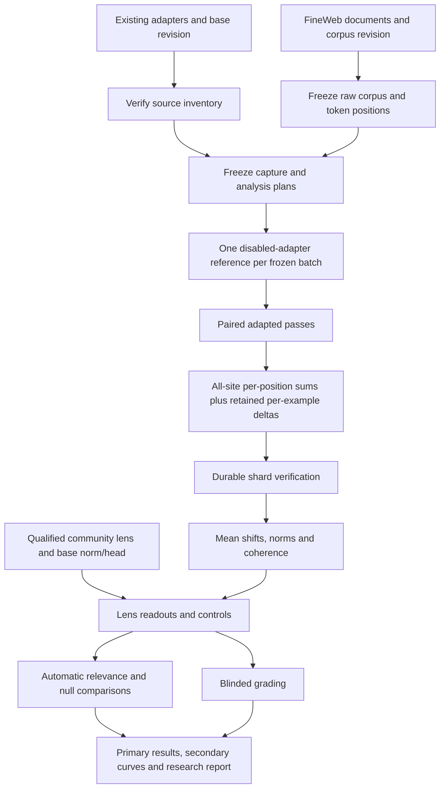

# Pilot 5: Readable traces of rank-1 SFT and GRPO

Status: design draft; decisions approved on 14 October 2026. Implementation and the scientific execution plan are not yet frozen.

Source: “Module 8 Pilot Spec Readable Traces of Rank-1 SFT vs GRPO (1).docx”, supplied 14 October 2026. This document resolves approved ambiguities and separates remaining proposals from decisions. The source document's timing and compatibility claims are not verified measurements.

## 1. Question and deliverables

Can a reader infer the GSM8K training task from average changes in internal activations elicited by unrelated text? Compare existing rank-1 gold-SFT and GRPO adapters with a random rank-1 adapter and random-vector controls. This is an auditability/readability experiment, not a correctness evaluation or causal steering experiment.

The main deliverables are a primary-cell table, readout lists, relevance-by-layer figures, sample-size/signal-to-noise curves, blinded grading with agreement evidence, and a research report with complete source provenance. A null is a valid result for this cohort, adapters and qualified readouts; it does not establish that all traces are absent.

No new model fine-tuning. The existing Pilot 2/4 checkpoint binaries are source inputs, not outputs to regenerate. Pilot 4's optional coefficient/KL branch is not a prerequisite for Pilot 5. Relevant source integrity must be checked independently.

## 2. Approved decisions

1. **Community Jacobian lens first.** Verify its artifact revision, hash, model identity, layer keys, dimensions and target representation. Own-lens fitting requires a separate proposal, budget and approval if compatibility or qualification fails.
2. **One primary position vector.** At decoder block index 14, average content positions 0–4 into one vector per example, then average examples. Positions 0–4 individually, 5–127 pooled, other blocks and other forms remain secondary.
3. **Durable retained shards.** Persist retained per-example activation shards and verify their checksums before GPU release. Local GPU disk is staging space, not the only copy of required evidence.
4. **Bounded zero-adapter checks.** Check both SFT-0 and GRPO-0 on a declared diagnostic cohort, with exact zero/integrity requirements. The cohort size and forms must be frozen before execution. These are qualification checks rather than full production zero-condition capture.
5. **Raw text only for the main execution; optional assistant support.** Approved by the user on 14 October 2026. Implement assistant-form rendering and an optional separate notebook script, disabled by default. Its execution is a separately named extension. User-turn support is deferred; main raw-only results make no role/template interaction claim.
6. **A separate, readable notebook.** `notebooks/pilot-5-colab.ipynb` is the planned execution surface. It must expose meaningful settings, objects and stage calls; scientific computations and process management belong in tested package modules.

The supplied spec proposed three forms. The user subsequently selected raw-only for the first execution, matching the reference extraction configuration. The user approved implementing an optional assistant-form extension invoked separately inside the notebook; it is disabled in the main run and requires its own frozen plan. User-form implementation remains deferred. Final-checkpoint-only capture has been recommended but has not yet been explicitly approved; retain it as a scope decision below.

## 3. Experimental objects

| Object | Identity and purpose |
|---|---|
| Source inventory | Model/tokenizer revision; eight nonzero learned checkpoints; random-64; both learned zero checkpoints; source files and SHA-256 |
| Corpus manifest | Original 150 FineWeb document identities plus 50 distinct eligible documents; revision, text/content hashes, selection procedure |
| Rendered sequence | Example ID, input form, exact token IDs, attention/position IDs, content-relative index mapping and template hash |
| Capture plan | Source inventory, ordered batches, runtime, hook sites, retained layers, accumulation/storage precision, integrity policy |
| Capture shard | Paired base/adapted sufficient sums, per-example retained deltas, baseline data needed for baseline readouts, numerical diagnostics and seal |
| Lens artifact | Artifact revision/hash, source sites, target representation, matrix shapes, final norm/unembedding convention, qualification evidence |
| Readout record | Vector identity, lens, positive/negative top tokens, raw scores, norm/coherence and control identity |
| Grading bundle | Opaque list IDs, token lists, task candidates, rubric and hidden condition mapping stored separately |
| Analysis/report plan | Primary family, null procedure, reference vocabulary, bootstrap draws, sample-size settings, predictions and inference boundaries |

Every derived object points to its frozen parents. A notebook variable is a convenience reference; saved manifests determine identity and completion.

### Matrix

- Base model: Qwen/Qwen2.5-1.5B-Instruct; resolve the full existing pinned revision rather than a short revision prefix.
- Learned conditions: SFT and GRPO at steps 8/16/32/64 = eight nonzero conditions.
- Adapter control: random-64, norm-matched to GRPO-64 = one condition, not a null distribution.
- Zero checks: both SFT-0 and GRPO-0 binaries. The user approved bounded qualification for both; its diagnostic cohort is still to specify.
- Corpus: 200 eligible documents, 128 content tokens each, with shared document membership across forms.
- Main form: raw text only. Optional implemented assistant form: same documents supplied after a fixed neutral user prompt and the assistant header. User form is deferred.
- Capture sites: embedding output plus all 28 decoder block outputs. Indexing must distinguish `embedding` from `block:0` through `block:27`; do not rename a 29-site array index as a decoder layer number.
- Retained per-example sites proposed in source: decoder blocks 14, 17, 18, 19, 20, 21.

With raw-only input, four learned checkpoints per arm plus random-64 require 1,800 adapted sequence forwards and 200 base sequence forwards: **2,000 total**, plus bounded qualification checks. If final-checkpoint-only scope is approved, base + SFT-64 + GRPO-64 + random-64 require **800 sequence forwards**. These counts do not include qualification/readout checks and do not imply a measured runtime. Intermediate checkpoints remain a pending scope choice.

## 4. Measurement and readout pipeline



For example n, block l and content position j:

`delta[n,l,j] = adapted_hidden[n,l,j] - base_hidden[n,l,j]`.

The primary per-example vector is the mean of the five deltas at positions 0–4 at block 14. Its cohort mean is the vector read by each lens. Compute differences from FP32 activations before storage conversion; accumulate sums in FP64. Pool by example so bootstrap draws preserve correlation among the five positions.

The relative mean shift is `norm(mean_delta) / mean(norm(base_hidden))`; coherence is `norm(mean_delta) / mean(norm(delta))`, with precise position pooling declared. Zero denominators remain undefined. These contextualize readability but are not lens probabilities or causal contribution fractions.

A reference can be shared within a batch only while base weights and disabled-adapter outputs remain invariant. Sharing a reference does not remove the need for per-example pairing, exact token alignment, or end-of-batch integrity evidence.

### Raw input and position alignment

Raw form uses the pinned tokenizer without a chat template. Actual special-token behaviour must be verified against the reference implementation and pinned tokenizer. For this Qwen, do not assume position 0 is BOS: distinguish first content token, template tokens and any explicitly inserted token in the manifest.

Assistant rendering is included as optional implementation, outside the default raw execution. It must preserve document membership, verify content-relative token alignment and record template/header positions separately. Its neutral user prompt is the supplied spec’s “Continue the text.” User rendering is deferred. Raw-only results cannot test whether readable traces depend on conversational role or formatting.

### Lenses

The logit lens uses the actual final RMSNorm gain and unembedding. Positive and negative token rankings are stored separately. For a nonzero Qwen RMSNorm input, its scalar normalization leaves within-vector ranking unchanged; this is not a claim that softmax probabilities or nonlinear interventions are scale-invariant. A zero vector has no informative ranked list and must be marked uninformative rather than assigned arbitrary tied tokens.

The Jacobian lens must have its source and target activation convention verified, including whether final normalization is included by its consumer. Fit provenance cannot be inferred from a filename. Qualification failures block Jacobian claims and trigger the separately approved fallback route; they do not justify silently relabelling another lens.

Reference implementation inspection supports raw extraction by default; its supported chat procedure focuses on assistant content and is not identical to Pilot 4's user-content view. State these distinctions in the report.

Outlier-channel ablations are secondary readouts. Select channels from independent base-only evidence and freeze the selection before adapted readouts; the supplied partial channel list is not sufficient to implement a top-eight rule. Retain the unablated primary result.

## 5. Controls and inference

- Random adapter: one weight-norm-matched realization, passed through the same capture/readout pipeline.
- Random-vector control: proposed 200 Gaussian vectors per declared site/readout family, with a frozen seed and covariance/isotropy convention. Norm scaling does not alter a linear lens's ranking; record magnitudes without using norm matching as evidence of equivalent signal-to-noise.
- Baseline activations: read base means and adapted means with the same qualified readouts.
- Both zero adapters: exact zero paired writes on qualified same-batch inputs; tied readouts are explicitly uninformative.
- Sample-size analysis: N=25/50/100/200 from retained per-example evidence. Resample whole examples and preserve all positions/conditions within a draw.

The primary claim is raw-form, block 14, pooled content positions 0–4, step 64. Two arms and two readouts still create multiple comparisons. The null-testing family and correction must be specified before capture/readouts. Per-position, depth, form, checkpoint and outlier-ablation searches cannot be promoted afterwards to the primary claim.

The automatic vocabulary contains 200 GSM8K-enriched token IDs, selected before any readout. Resolve the exact training-solution source, background corpus, smoothing, count definition, exclusions and ties. Relevance is top-20 membership fraction in this frozen vocabulary, not ground-truth semantic task identification.

Blinded grading uses opaque IDs and a separated condition map. Freeze the eight candidate tasks, relevance rubric, grader model/version/settings, list sampling and human review schedule. Token lists contain data, not instructions to the grader. Grader calls require explicit approval and a cost estimate before external submission.

Matched signal-to-noise is an analysis definition, not an implementation detail. Proposed vector-noise definition: root mean squared error of the example-mean vector, using `sqrt(trace(sample covariance)/N)`. Then SNR is `norm(mean_delta)/noise`. Its use, resampling/interpolation and uncertainty procedure remain proposed. Similar SNR is not a causal adjustment and does not establish equal information content.

Register predictions with user/team-supplied confidences before inspecting Pilot 5 outcome lists. The source's draft confidences are not approved values. The observational Stage 0 first look must be labelled exploratory and its influence on design disclosed; preferably freeze primary definitions and vocabulary first.

### Storage versus readout coverage

Per-position sums are retained at all 29 named sites for all 128 content positions. Full per-example token differences are retained only at the six declared blocks. Readouts apply to cohort-mean vectors, not every example-token difference. Grading applies to selected token lists and does not require every stored vector to receive a human/LLM grade.

For the raw sequence, the user suggested first-four and last-four content positions as a possible smaller secondary grid. This remains a proposal: it does not replace the approved pooled 0–4 primary vector. A recommended bounded presentation is pooled early/late windows across depth, with individual position lists inspected at the primary block. Exact windows and full readout coverage must be frozen before results are inspected.

In the optional assistant-form extension, content position zero is the first supplied assistant content token after the neutral user prompt and assistant header. It is distinct from a header token. Boundary/header vectors, if requested, are a separately labelled measurement rather than silently substituted for content vectors.

Both lenses directly produce ranked vocabulary tokens/scores. Automatic relevance and blinded grading are downstream assessments, with the raw token lists always retained and displayed. A relevance score is membership in the predeclared 200-token task-enriched vocabulary; it is not a substitute for seeing the lens output.

## 6. Modules and responsibilities

Proposed package boundaries; these are design interfaces, not existing implementations:

| Module | Main public interface | Responsibility |
|---|---|---|
| `trace_sources.py` | `inspect_sources(selection)` | Reuse existing source validators; produce explicit compatibility inventory |
| `trace_inputs.py` | `prepare_corpus(settings, sources)` | Document selection, raw tokenization and optional assistant rendering, map positions, freeze IDs/hashes |
| `trace_capture.py` | `qualify_capture(plan)` / `capture(plan)` / `verify_capture(plan)` | Extend validated model/integrity boundaries with named-site per-position summaries and retained shards |
| `trace_lenses.py` | `inspect_lens(artifact)` / `qualify_lens(plan)` / `read_vectors(plan)` | Separate artifact compatibility, mathematical readout and qualification |
| `trace_analysis.py` | `build_controls(plan)` / `analyze(plan)` | Frozen vocabulary/nulls, example bootstrap, sample-size curves and primary-family results |
| `trace_grading.py` | `prepare_blind_bundle(plan)` / `import_grades(bundle)` / `unblind(plan)` | Opaque identity mapping, provenance, external-grade import and audit |
| `trace_report.py` | `build_report(plan)` | Research narrative, tables, figures, limitations and prediction outcomes |
| `pilot5_session.py` | `restore_session(...)` / `show_inventory(...)` | Notebook-facing state restore and named artifact references, backed by existing process helper |

Share existing immutable writers, locks, hashes, safe paths and one-model execution boundaries. Do not add Pilot 5 branching throughout Pilot 4's scientific math. Keep capture, readout and inference stages independently reproducible from saved parents.

## 7. Readable notebook contract

The dedicated notebook is a small execution guide. Every cell has: purpose, CPU/GPU requirement, inputs, outputs, and a named stage call. Main code is normal Python using named objects and explicit imports. No business logic hidden in an unlabelled dictionary merge, editable field containing a Python expression, or a giant subprocess error-recovery block.

Example intended style:

```python
# Inspect sources and restore saved stage completion; no model loading.
project = restore_session(artifact_root=ARTIFACT_ROOT, pilot="pilot-5")
sources = inspect_sources(project.source_selection)
show_inventory(project, sources)
```

```python
# Capture missing units only; progress includes arm/form/checkpoint and durable units.
capture_result = capture(project.capture_plan)
verify_capture(project.capture_plan)
```

The real implementations must make these objects inspectable and serializable. Examples above are interface sketches, not runnable notebook cells yet.

Proposed notebook cells:

| Cell | Hardware | Work | Saved output |
|---|---|---|---|
| 1 | CPU | Mount storage, load pinned code, restore named project | Source selection, restored inventory |
| 2 | CPU | Inspect adapter, corpus and lens availability | Compatibility inventory and missing prerequisites |
| 3 | CPU | Prepare raw corpus and automatic reference vocabulary | Corpus/form manifests, tokens, vocabulary |
| 4 | CPU | Review and freeze primary analysis and predictions | Analysis plan and prediction registry |
| 5 | CPU | Optional existing-data logit-lens first look | Clearly labelled exploratory readouts; no per-position claim |
| 6 | GPU | Environment readiness, bounded numerical/capacity qualification and profiling | Qualification report, capacity/timing/storage estimate |
| 7 | CPU | Review measured budget and freeze execution | Capture and readout execution plans |
| 8 | GPU | Capture/resume raw input and planned conditions | Sealed sums and retained activation shards |
| 9 | CPU/I/O | Sync and verify durable capture inventory | Durable-storage completion seal and release boundary |
| 10 | GPU if required | Qualify the community lens and run required GPU readouts | Qualified lens manifest and readout records |
| 11 | CPU | Controls, relevance, bootstrap and sample-size/SNR analysis | Structured statistics and figures |
| 12 | CPU | Prepare blind grading bundle; separately import approved grades | Bundle and grade provenance |
| 13 | CPU | Verify grading completion and unblind | Condition-joined results and agreement summaries |
| 14 | CPU | Research report, prediction outcomes and verified export | Final report, figures, source inventory |
| Optional extension | CPU preparation / GPU capture and qualification / CPU analysis | Explicit assistant-form script, disabled by default; execute separately from the raw sequence | Separate assistant plan, shards, readouts and report |

Lens availability/qualification should be checked before committing to full capture, even if cell 10 owns the complete readouts. GPU session grouping is planned from measured capability: qualify lens and capture in one session where practical, or defer bounded readout work with all activation evidence durable. CPU readouts from matrices are possible, but the spec's blanket “everything after stage 2 is CPU” conflicts with stage 3 qualification and optional fitting; the inventory declares actual hardware needs.

### Optional assistant script inside the notebook

Provide a dedicated entrypoint, planned as `scripts/pilot5_assistant_extension.py`, invoking the same public source/capture/lens/analysis interfaces. The notebook exposes one labelled optional launcher and readable settings (`RUN_ASSISTANT_EXTENSION = False`, source raw plan, extension name). It must not duplicate scientific math or appear as an operational repair cell. Enabling the extension displays its stage inventory, GPU requirements and workload before execution; it respects the same profile/review and durable-release boundaries as the main run.

The assistant corpus uses the same document IDs and text, after “Continue the text.” and the pinned assistant header. Store content-relative and absolute positions, and verify boundary tokenization explicitly; the extension is not a second random corpus or generated continuation. Its base activations must be captured for the new formatted sequence: raw base activations cannot be reused. Model/tokenizer/adapter binaries can be reused. Output identities include the form, prompt/template and token hashes, so raw results remain unchanged.

The extension is secondary and reports raw/assistant contrasts with the qualification that prompt, formatting and positions change together. No role-only causal claim follows. Same-condition comparisons and compatible readouts are required; failure of a lens on one form must remain visible. It adds one form’s production workload (800 sequence forwards if endpoint-only is approved; 2,000 for the full trajectory) plus separate qualification and analysis. The notebook does not run this script automatically during the raw run.

### Operational rules learned from Pilot 4

- Setup restores completion and saved selections; it never launches training or old capture stages.
- No `Run all` requirement for resuming. Print the next pending stage and CPU/GPU grouping.
- Install pinned text-model dependencies and test actual imports before paid work. Avoid conflicting optional vision/audio wheels.
- Runtime checks separate source identity, scientific numerical settings and hardware compatibility. No automatic rewrite of existing source contracts; a proposed compatibility bridge must be qualified and approved if needed.
- One canonical measured pass order and batching contract. Record batch sensitivity; do not claim exact cross-batch or cross-device equality from deterministic flags.
- Verify hashes at meaningful integrity boundaries and artifact reuse. Do not silently weaken integrity, or rebuild/read every large parent repeatedly at each stage without an explicit verification budget.
- Qualification is bounded and reports its matrix before starting. Production reports completed and sealed units, phase, throughput and measured ETA; a heartbeat is labelled as liveness only.
- A stage saves explicit failure location and bounded token/module diagnostics. No repeated repair cells should be required for ordinary operation.
- CPU work should not hold a paid GPU by default. Release only after children exit and required artifacts are durably verified.

## 8. Artifact tree and storage budget

```text
artifacts/
  plans/pilot5-readable-traces-<execution>/
    sources.json
    corpus.json
    analysis.json
    capture.execution.json
    readout.execution.json
  runs/pilot-5-readable-traces/Qwen--Qwen2.5-1.5B-Instruct/<execution>/
    inputs/<form>/items.json
    qualification/
    capture/<form>/<condition>/shards/batch-XXXX/
      sums.npz
      retained-deltas.npz
      metadata.json
      diagnostics.json
      complete.json
    lens/
    readouts/
    grading/
    results/
    meta/status.json
    meta/run_manifest.json
    checkpoints/progress.json
    complete.json
  reports/pilot5-readable-traces-<execution>/
```

Partition sealed shards by batch so interrupted work repeats only the incomplete unit. Base payloads are stored once per compatible form/batch and referenced by hash. Derived stage identities bind parents; changing a form, readout policy or primary definition creates a new named product.

At 200 × 6 × 128 × 1536 × 2 bytes, retained FP16 deltas are 471,859,200 bytes, or 450 MiB per condition/form before compression. For the approved raw-only form, nine nonzero conditions give about 3.96 GiB; endpoint-only would retain three nonzero conditions at about 1.32 GiB. The three-form estimate of 11.87 GiB is deferred scope. Retained base data adds about 0.44 GiB per form. Full retained zero conditions add about 0.88 GiB per form. All-site FP64 sums add about 43.5 MiB per vector-valued array, plus manifests/diagnostics and temporary copies. Compression and actual free space must be measured.

Capture precision remains FP32 and accumulation FP64. FP16 retained delta storage is a source proposal requiring a storage-quantization check for bootstrap and ranking sensitivity; exact sums do not justify calling FP16 bootstrap evidence exact. Persist all evidence required by the approved inference plan before GPU release.

## 9. Testing and release gates

Use the already approved public saved-workflow seam plus independent tiny CPU model/math oracles. Proposed checks:

- Offset/position alignment with hand-worked raw/user/assistant examples and no presumed BOS.
- Exact zero writes for both zero adapters; finite/rank-1/base integrity checks.
- Named embedding/block hook indexing against an independent tiny-model oracle.
- Streaming sums equal an independent full-array calculation; primary position pooling verified separately.
- Positive scaling preserves nonzero readout ranking; zero vectors are uninformative; final norm gain is retained.
- Lens matrix dimensions/site/revision failures stop qualification with clear diagnostics.
- Controlled interrupted capture preserves source bytes and sealed units; resume does not duplicate examples.
- Durable sync verifies hashes and prevents a false GPU-release message if retained shards are missing.
- Fixed-seed nulls/bootstrap, no metadata leakage into blinded grading, and primary/secondary separation.
- Notebook readability and fresh-kernel restoration through the real public stage interfaces.

GPU gates and thresholds are frozen before production. The source's relative 1e-6 reproduction threshold is not adopted silently: it can fail at zero/near-zero or across different batching/runtime/input forms. First define the genuinely overlapping Pilot 4 execution and same tokens/sites/aggregation; independently qualify numerical agreement before comparison. Do not loosen a failed threshold to pass a new run.

## 10. Remaining decisions before execution freeze

1. Final-checkpoint-only versus full trajectory, bounded zero-check cohort, and the secondary readout position/layer grid. Raw-only scope is approved.
2. Primary multiple-testing family across arms/readouts and exact null statistic/correction.
3. Relevance-vocabulary smoothing/exclusions, exact 50-document extension procedure, null/bootstrap seeds and replicate counts.
4. Retained precision qualification and SNR estimator/matching procedure.
5. Lens compatibility outcome; primary readout availability and independent qualification criteria.
6. Outlier-channel selection rule; eight grader task candidates, grader model/rubric/cost and human sample selection.
7. Accepted prediction confidences and how prior Stage 0 exposure is disclosed.

These are open proposals, not executable defaults. Patchscope is a separately approved later extension; its nonlinear/scaled intervention readout must not be bundled into linear-lens claims.

## 11. Source checks

- Minder et al., paper and readout method: https://arxiv.org/html/2510.13900v1
- Reference raw/chat configuration: https://github.com/science-of-finetuning/diffing-toolkit/blob/main/configs/diffing/method/activation_difference_lens.yaml
- Position/input extraction: https://github.com/science-of-finetuning/diffing-toolkit/blob/main/src/diffing/methods/activation_difference_lens/method.py
- Final-norm/unembedding readout: https://github.com/science-of-finetuning/diffing-toolkit/blob/main/src/diffing/utils/model.py
- Community lens card: https://huggingface.co/qbz506/prabodha-lenses
- Jacobian lens code and serialization: https://github.com/anthropics/jacobian-lens

The inspected community card describes 16 Wikitext prompts; its exact binary source keys, target convention and base-model revision remain unverified. The source's “about one A100-hour” fallback and “under 30 minutes” capture estimates are hypotheses to profile, not cost commitments. Verify immutable revisions and binary metadata before execution.

## 12. Ticket-review refinements (14 October 2026)

The revised proposal separates corpus preparation from vocabulary/inference review. Capture may proceed once its source/capture plan and predictions are frozen, but learned token lists cannot be exposed (including previews) until the outcome-dependent vocabulary/inference commitments are frozen. Numerical/tiny/base-model qualification does not reveal the adapters’ task traces.

Community-lens inspection runs from the shared site contract in parallel with bounded capture qualification. Its status/site requirements inform capture freeze; an incompatibility stops Jacobian claims and requires separate approval for fitting or a partial logit-only primary design. Capture correctness failure always stops capture. An unaffordable profile prompts declared, explicitly reviewed reductions rather than automatic changes to the primary cohort or tolerances.

Automatic reporting and required raw-path Colab regression do not wait for human grades or optional assistant work. An early minimal real-Colab smoke finds deployment risks before dependent work; optional assistant isolation is checked within its own extension. Grade supplements attach later under a stable schema. The revised proposal has 13 tickets because corpus and vocabulary were split; no additional capture-hardening ticket is currently proposed.

## 13. Retention and review ownership refinement

Capture-plan freeze is the sole owner of sites, positions, pooling, conditions, stored precision, retention, primary-vector identity and predictions. Vocabulary/inference review owns only reveal/scoring rules within that data contract. Add FP64 per-example pooled primary-window vectors at all 29 sites (delta and base plus required norm/count scalars) while preserving the existing six-block all-position per-example shards and all-site position-wise sums. At width 1,536, a 200-example pooled all-site vector array is 71,270,400 bytes (67.97 MiB) per condition; six-block FP16 position-wise evidence is 450 MiB per condition. The review’s width 3,584 is a hypothetical example, not this model.

This supports whole-example primary-window analyses across depth and arbitrary retained-position analyses at the six blocks. It does not supply per-position bootstrap/SNR outside those blocks. Such requests are outside the allowed analysis family and require a reviewed extension. Retention cannot silently shrink from token-level evidence to pooled-only evidence.

The added 50 documents are selected without consulting outcomes. Preserve legacy/new labels and predeclare primary robustness results for each stratum, accounting for unequal sample sizes and noise. Record reviewer exposure to earlier pilot outputs; no prior token-list exposure is assumed without evidence.

Prasad owns outstanding scientific/budget decisions. Lens or budget failure saves evidence, stops paid work and releases safely before asking for fallback approval; no automatic fitting or logit-only primary change. Vocabulary approval pauses learned-list reveal, while otherwise qualified capture can continue. The barrier is an accidental-exposure safeguard, not protection against deliberate artifact access.

The initial notebook bootstrap has a minimal grade status/schema-version contract; detailed grade fields are deferred. Early real Colab import/storage smoke requires actual GPU validation and cannot be declared fully passed using CPU mocks. Readable-code assessment is labelled a reviewer check.

## Corpus implementation decision · 2026-10-14

The user approved the same pinned first-2,000 FineWeb pool, duplicate/legacy exclusion, minimum 128 content tokens, separate local seed 42 and preservation of source order for the added 50. See ADR 0012 for the input verification scope. Real pinned-data preparation remains pending; completed bootstrap evidence does not qualify model capture.
