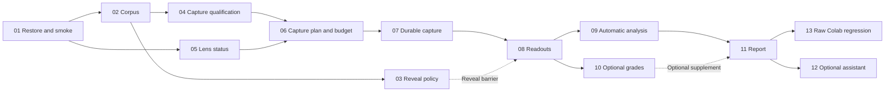

# Pilot 5 implementation tickets

Status: ready-for-agent. Published after applying the second supplied review. The public saved-workflow seam is approved; paid scientific execution retains its review gates.

| Ticket | Capability | Blocked by |
|---|---|---|
| [01](01-restore-and-colab-smoke.md) | Restore a clean session, audit sources and smoke-test Colab | None |
| [02](02-freeze-raw-corpus.md) | Prepare and freeze the raw corpus | 01 |
| [03](03-freeze-vocabulary-and-reveal-policy.md) | Freeze vocabulary and inference commitments before outcome reveal | 02 |
| [04](04-qualify-paired-capture.md) | Qualify bounded paired capture and logit-lens mathematics | 02 |
| [05](05-qualify-community-lens.md) | Inspect and qualify community Jacobian-lens status | 01 |
| [06](06-freeze-capture-budget-and-predictions.md) | Profile and freeze the explicit production plan and predictions | 04, 05 |
| [07](07-capture-resume-and-durable-release.md) | Capture, resume and durably verify raw evidence | 06 |
| [08](08-decode-controlled-readouts.md) | Decode saved means and reveal controlled token lists | 07, 03 |
| [09](09-automatic-relevance-and-robustness.md) | Produce automatic relevance and sample-size results | 08 |
| [10](10-blinded-grading-supplement.md) | Prepare blinded grading and add validated grade evidence | 08 |
| [11](11-research-report-and-handoff.md) | Publish the automatic research report and verified handoff | 09 |
| [12](12-optional-assistant-extension.md) | Add the optional assistant-form script and its isolation check | 11 |
| [13](13-fresh-colab-raw-validation.md) | Validate the completed raw notebook in fresh Colab | 11 |

## Main graph

The dashed grade-supplement edge is not an implementation blocker. The reveal-policy edge is a scientific exposure gate. Neither optional grading nor assistant execution gates the required automatic report or raw validation.

Start with 01. Its offline implementation checks and real Colab smoke have separate evidence status; no full scientific run is authorized by ticket completion.

## Qualification handoff status · 2026-10-16

**Inspection complete, profile complete, JLens acceptance pending.** The numerical qualification producer is now exposed in notebook **20A–20C**, before production. Execution and reviewed acceptance are still required; `qualified: false` is not merely an administrative checkbox. Ticket 05 is partial. Ticket 04/06 capture numerical acceptance and production scope/budget/predictions remain separate gates. See [bounded JLens workflow](../../../docs/pilot5-jlens-qualification.md). No completion claim for 04–06 follows from the later capture/readout consumers being implemented.
