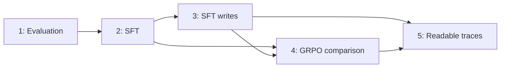

# Experiments

The five pilots form a sequence of evaluation, training and measurement
experiments. Each page records the question, configuration, outputs, evidence
status and limitations. Actual frozen execution configs identify the run;
notebook defaults and original specifications may describe a different variant.

1. [Pilot 1 — behavioral baseline](pilot-1.md)
2. [Pilot 2 — rank-1 SFT](pilot-2.md)
3. [Pilot 3 — fixed-input SFT writes](pilot-3.md)
4. [Pilot 4 — rank-1 GRPO and paired measurements](pilot-4.md)
5. [Pilot 5 — readable traces](pilot-5.md)

## Follow-ups

- [Sampling SFT — source preparation and data recipes](sampling-sft.md)

## Dependencies

Pilot 4 and Pilot 5 reuse the trained SFT adapter. Pilot 5 reuses the GRPO and
random adapters; its execution does not depend on Pilot 4 KL completion.

[Status and evidence ledger](status.md) is the consolidated execution record.
[Methods](../methods.md) defines shared quantities.
[Artifacts](../artifacts.md) describes source access and verification.
[Operations](../operations/README.md) contains execution-specific instructions.

The `.scratch/` specifications, ticket records and dated ADRs retain design
history. Later explicit reviews and amendments can supersede their original
status or scope. Those records are not rewritten to imply prospective decisions.
