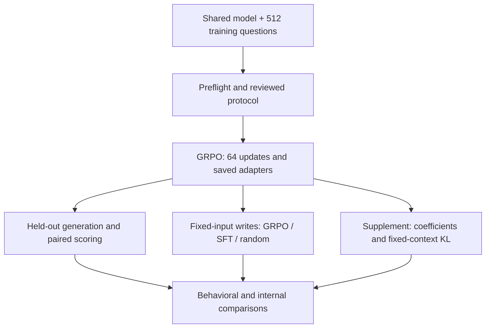

# Pilot 4 — rank-1 GRPO and paired measurements

## Questions

Does rank-1 GRPO preserve or improve held-out arithmetic performance? How do its
fixed-input internal changes differ from SFT and a norm-matched random adapter?
Do local rank-1 coefficients and output-distribution KL add information beyond
write magnitudes and behavioral accuracy?

## Design and configuration

| Field | Recorded training execution |
|---|---|
| Model | Pinned Qwen/Qwen2.5-1.5B-Instruct, shared with SFT |
| Training items | Same 512 GSM8K training problems used by SFT |
| Adapter | Rank 1, alpha 1, dropout 0; all seven projection types in 28 blocks |
| Training | 64 updates; 8 problems × 8 sampled completions per update; 4,096 accepted draws |
| Sampling | Temperature 1, top-p 1, top-k 0; frozen completion cap 1,024 |
| Objective | DAPO loss; group-scaled rewards; one iteration; beta 0 |
| Reward | GSM8K flexible-v3 correctness |
| Optimizer | AdamW, LR 1e-4, betas 0.9/0.999, epsilon 1e-8; constant schedule, no warmup/weight decay; gradient clipping 1 |
| Runtime | Unquantized FP32, eager attention, TF32 off; training recorded on A100 80GB |
| Checkpoints | 0, 8, 16, 32, 64 |

Actual frozen plans govern batching, precision, cap and source identities. A
zero-adapter check and disposable training/memory trials preceded the reviewed
training freeze. The disposable updates are not part of the trained arm.

## Pipeline

Behavior uses the identical 150 held-out GSM8K items: greedy at five checkpoints
(750 responses), plus eight sampled draws at steps 0 and 64 (2,400 responses).
Sampled accuracy averages rewards across draws within each item and then across
items; it is not pass-at-eight. Both strict and flexible-v3 scores are retained.
The frozen greedy non-inferiority margin is 0.10; its paired interval rule must
be used rather than comparing point estimates alone.

The write comparison uses the Pilot 3 fixed GSM8K/FineWeb inputs. SFT was
remeasured separately on the matching A10040 runtime and batch 8; this did not
retrain SFT or regenerate its behavioral answers. The random control matches
GRPO-64 module norms. It is one reference adapter, not a null distribution and
not an independently SFT-matched control.

## Results and execution status

The preserved 13 October result snapshot records training completion: 64 updates,
4,096 accepted draws and unchanged frozen base weights. Greedy flexible-v3
accuracy rose from 0.6800 at step 0 to 0.7600 at step 64. This is one training seed.

Matched A10040 endpoint write reports contain these final-block token-weighted
relative changes, `norm(mean(delta)) / mean(norm(base))`:

| View | SFT-64 | GRPO-64 | Random-64 |
|---|---:|---:|---:|
| GSM8K question | 7.757% | 17.431% | 0.03314% |
| GSM8K solution | 8.126% | 17.070% | 0.03649% |
| FineWeb content | 1.8373% | 0.8175% | 0.02417% |

These descriptive summaries do not establish a causal mechanism or a significant
cross-arm difference. They come from preserved report JSON, not a new audit of
all Drive arrays. The later comparison cell 27 was reported complete by the user;
its full output was not reimported into this local snapshot.

The supplemental coefficient/KL workflow is implemented. Its original v1 profile
failed a singleton-versus-batch coefficient gate. The accepted v2 amendment uses
fixed matched batches and reports that sensitivity descriptively while retaining
repeat/chunk, reconstruction, KL and integrity gates. **No completed v2 production
result is established by the evidence available for this documentation refresh.**

## Outputs

Frozen training plan; sampled training responses/rewards and step diagnostics;
sealed checkpoints; held-out responses and paired behavioral report; per-example
write summaries and figures; random-control construction evidence. The remaining
supplement produces signed per-token coefficients, fixed-context KL and their
summaries; final handoff verification follows that work.

## Limitations

Fixed-context KL is a post-training diagnostic, not the training KL penalty
(beta is zero). Coefficients depend on the actual adapted-pass input and batching.
Raw local writes, propagated block differences, KL and accuracy measure different
objects. A shared seed and input cohort do not remove all training-method
confounds. Hardware timing comparisons require measured workloads.

## References

- [Specification](../../.scratch/pilot4-grpo/spec.md)
- [Training guide](../pilot4-grpo.md)
- [Fixed writes](../pilot4-fixed-writes.md)
- [Coefficient/KL workflow](../pilot4-token-measurements.md)
- [Batch-sensitivity amendment](../adr/0010-pilot4-coefficient-batch-sensitivity.md)
- [Final handoff](../pilot4-final-handoff.md)
- [Notebook](../../notebooks/pilot-4-colab.ipynb)
- Local snapshots: `artifacts/reports/pilot4-results-so-far-2026-10-13/` and `artifacts/reports/pilot4-a10040-v2-review/`.
