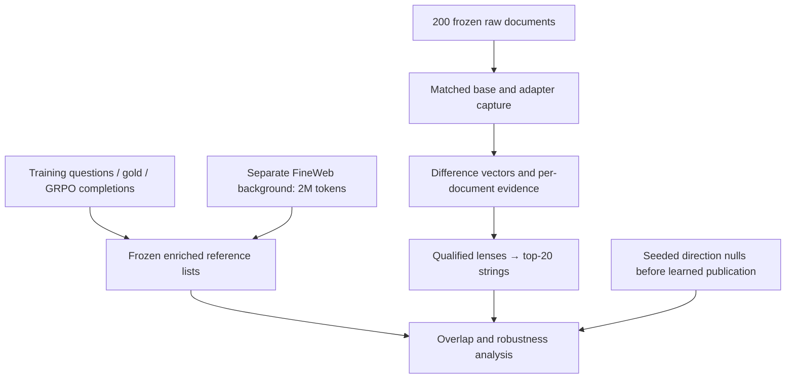

# Pilot 5 — readable traces of fine-tuning

## Questions

Can the mean activation difference induced by SFT or GRPO be read as task-related
vocabulary on unrelated fixed text? Does this interpretation survive document
resampling and comparison with random directions, random adapters and ordinary
activation readouts? How sensitive is it to the lens, position and sample size?

## Design and configuration

| Field | Approved primary production |
|---|---|
| Model | Same pinned Qwen/Qwen2.5-1.5B-Instruct and saved adapters |
| Conditions | Untuned, SFT-64, GRPO-64, random-64; intermediate checkpoints omitted |
| Inputs | 200 raw FineWeb documents: original 150 plus 50 separately selected; 128 content tokens each |
| Formatting | Raw text; assistant form is an optional extension, outside this primary run |
| Capture | Embedding output plus all 28 decoder block outputs: 29 named sites |
| Primary vector | Mean adapted-minus-untuned activation, block index 14, pooled positions 0–4 |
| Forward / accumulation / retention | FP32 / FP64 / FP32; reviewed batch size 4 on T4 |
| Readouts | Positive top-20 normalized unique strings from logit and scoped Jacobian lenses |
| Primary score | Overlap with the frozen 200-string question reference |
| Primary family | SFT/GRPO × two lenses: four one-sided tests, Holm correction |

Block 14 means the fifteenth decoder block, not the fourteenth saved site.
Primary evidence is endpoint-only. The zero adapters received bounded instrument
checks, not full production capture.

## Pipeline and saved objects

References are constructed from 512 training questions, their gold answers and
4,096 GRPO training completions. A bounded scan of 10,000 FineWeb documents supplies
2 million background tokens, excluding the capture cohort. Counts are compared
using the approved informative-prior log-odds enrichment procedure (prior mass
1,000, minimum task count 5, positive enrichment); the top 200 eligible normalized
strings define each reference. The background is a CPU counting input, not an
additional 10,000-document transformer capture. Reference membership indicates
task enrichment, not a binary classification of every other string as general.

Capture retains three complementary products:

- FP64 per-position cohort sums across all 29 sites and 128 content positions.
- Per-document pooled positions 0–4 differences at all sites, supporting document bootstrap.
- Per-document individual-position differences at selected blocks 14 and 17–21, with retention precision recorded.

Pooled base/adapted vectors support baseline readouts. Complete individual-position
base activations are not a universal retained product. Arrays, masks, document IDs,
source hashes and completion inventories define the actual saved population.

## Decisions

The reviewed prereveal prediction is approximately 20–35% primary top-20 overlap
with `ref_questions` for each learned arm through each lens, with stated
confidence 0.6. This is a recorded prediction, not a measured result.

The community Jacobian lens is used only after compatibility and numerical
qualification. Fitting a replacement requires separate approval. Its accepted
scope is block 14 pooled positions 0–4; other JLens layer/position results are
unavailable. The producer's fitting excluded early positions, so applying it here
has a disclosed transfer limitation. Numerical qualification does not demonstrate
semantic faithfulness.

References and analysis procedures freeze before learned token-list publication;
analysis records prior exposure detectable in supported artifacts. Nulls use
1,000 seeded isotropic directions per declared schedule. A covariance-shaped null
is not qualified. Whole documents are resampling units. Primary intervals use
1,000 bootstrap draws; direct arm contrasts use 2,000 paired draws and a separate
two-lens correction. The bootstrap-tail contrast statistic has no established
nominal calibration. Layer/position curves, subgroup and N-curves are secondary.

## Execution status

Corpus/reference preparation, bounded diagnostics, T4 profiling and reviewed
lens/capture qualification have execution evidence. The supplied production log
records **200 documents × four conditions = 800 sequence forwards, 200 batched
model calls**, capture complete and durable verification successful. It reports
6,767,685,878 bytes before final metadata (about 6.30 GiB). This is disk storage,
not GPU memory. [Evidence summary](evidence/pilot5-capture-summary.json).

The user subsequently reported cell 24 complete and cell 25 running. Completed
learned readouts and automatic relevance results have not been supplied for this
refresh. Tickets 07–09 implement capture, readouts and automatic analysis; passing
software tests does not establish those scientific results. Human grading and
final presentation remain later work. See the [status ledger](status.md).

## Outputs and limits

Durably sealed capture shards and moments; reviewed readout requests; lens asset
and qualification receipts; token lists and normalization provenance; frozen null
scores; overlap, paired/stratified bootstrap and N-curve results; structured JSON,
JSONL, NPZ and Markdown reports. Human grading adds a separate interpretation
check rather than replacing the automatic score.

A readable mean direction need not describe every document or token. Reference
overlap is lexical evidence; it does not prove reasoning, a causal circuit or that
this direction mediates the observed behavioral change. One random adapter is
not a random-direction null. Raw FineWeb is not guaranteed to contain no math.

## References

- [Specification](../../.scratch/pilot5-readable-traces/spec.md)
- [Corpus](../pilot5-corpus.md), [qualification/profile](../pilot5-lens-and-profile.md)
- [Capture and readouts](../pilot5-capture-and-readouts.md)
- [JLens qualification](../pilot5-jlens-qualification.md)
- [Prereveal review](../pilot5-prereveal-review.md)
- [Automatic analysis](../pilot5-automatic-analysis.md)
- [Notebook](../../notebooks/pilot-5-colab.ipynb)
