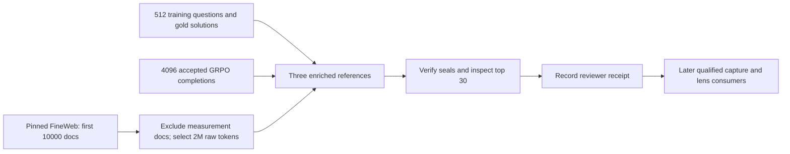

# Pilot 5 reference and prereveal workflow

Status: implementation complete; real CPU reference preparation and review pending.

## Run now

Use a fresh **CPU** notebook runtime. Run **1–2 → 10–12**. Existing smoke, source-audit and 200-document corpus artifacts are reused; skip 3–9. Read the three top-30 reference previews, then fill the review fields and run **13**. Keep exposure history honest: unknown history remains explicitly unverified.

## What is implemented

- `trace_reference_workflow.py`: public prepare/verify orchestration; exact parent identities; canonical procedure plan; saved run status.
- `trace_vocabulary.py`: normalized counts, informative-prior log odds, three references and sensitivities; immutable freeze/review; resumable background scan.
- `trace_scoring.py`: unique normalized top-token lists, overlap/soft-rank, null generators and verified scoring sessions.
- `trace_statistics.py`: paired document bootstrap, declared p-values, Holm correction, SNR, N-curves, stratum checks and resumable draw chunks.
- `trace_grading.py`: local blinded packages, separate private keys, raw grader-input persistence, agreement and settlement before condition joins. No API calls.
- `trace_review.py`: earlier exposure history and retained-data capability validation remain available.

Background scanning seals every 250 source documents. Interrupted unsealed work is repeated; completed chunks are verified and reused. A changed source or procedure is refused under the same identity. No model weights or GPU inference are needed. Real duration has not been benchmarked; network streaming and document lengths determine it.

## Artifact locations

`artifacts/runs/pilot-5/<experiment>/analysis/ticket03/` stores config, counts, references, preview, seals and status. `artifacts/plans/<experiment>-overlap-v1/overlap.config.json` stores the immutable procedure alias. The notebook uses saved explicit source paths, not a latest-file search.

## Scientific boundaries

The approved procedure is in `TICKET_03_PREFLIGHT.md`; the implementation evidence is in `TICKET_03_REPORT.md`. Real references and human review are still pending. Real nulls require qualified lenses; covariance-shaped nulls also need qualified base moments. Capture and lens qualification are later tickets. C3 implements the approved bootstrap-tail formula, whose nominal calibration is not established by the tiny synthetic diagnostic. Exposure receipts are self reports, and seals protect accidental changes rather than malicious history replacement. Supported consumers enforce the gate; deliberate file access is outside it.
