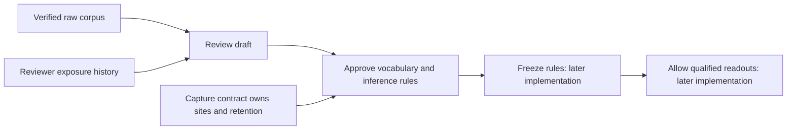

# Pilot 5 prereveal review

Status: partial implementation; scientific choices and real corpus verification pending.

The corpus fixes which unrelated text is measured. The capture contract fixes what vectors are saved. This review stage fixes how those vectors will be assessed before learned token lists are inspected.

## Implemented operations

- `traces-review-prepare --config <traces.corpus.json> --name <experiment> --output-root <root>` verifies the corpus and creates an immutable empty review draft. It lists six unapproved sections: vocabulary, primary testing, resampling, SNR, robustness and grading. It never grants reveal.
- `traces-review-exposure --event <event.json> --name <experiment> --output-root <root>` records a named reviewer’s exposure. The same event ID can be reused only with identical content; a correction requires a new event, preserving the original.
- `traces-review-inspect --name <experiment> --output-root <root>` restores and checks exposure history without importing model libraries. It currently always reports `reveal_allowed: false`; freeze and outcome consumers are not implemented yet.
- `validate_analysis_requests` rejects unsupported evidence requests. Position-wise cohort means exist at all 29 sites; pooled per-example positions 0–4 exist at all sites; per-example individual-position evidence exists only at blocks 14 and 17–21. These are data-availability checks, not approval of a statistical estimator.

Artifacts stay in `artifacts/runs/pilot-5/<experiment>/review/`. The draft binds the verified corpus configuration hash. Exposure records preserve reviewer, experiment, output type, description, observed date or explicit unknown date, and unknown history. They store descriptions, not lens token lists.

## Scientific decisions awaiting review

The proposed vocabulary rule has been presented to Prasad but is not approved or implemented: token occurrence counts in the exact 512 SFT gold solutions versus the actual frozen 200-document raw corpus, add-one-smoothed log frequency ratio, special/non-alphanumeric token exclusion, token-ID tie breaking and top 200 membership. Exact normalization support and treatment of unobserved training tokens still need to be stated in the final approved rule. No earlier held-out evaluation answers are substituted for training solutions.

Null distributions, the primary arm/readout family, correction and threshold, resampling counts/seeds, sample-size analysis, SNR estimator, legacy/new uncertainty interpretation and optional grading settings remain unapproved. Drafts keep them empty. Capture settings and the primary vector must be referenced from their owning capture contract, not redefined by this review module.

## Boundaries

A draft is not preregistration completion. A prior exposure record is self-reported history, not proof of blinding. A checksum detects accidental payload changes, not malicious rewriting of the entire history. This supported-operation barrier cannot prevent deliberate direct access to raw files. Later consumers must enforce the frozen review identity before revealing outcomes; those consumers do not exist yet.

No readouts, statistics, grading calls, model inference or GPU qualification have been run by this implementation. The notebook remains at its verified corpus release until this ticket is complete; no repair cells are needed.
