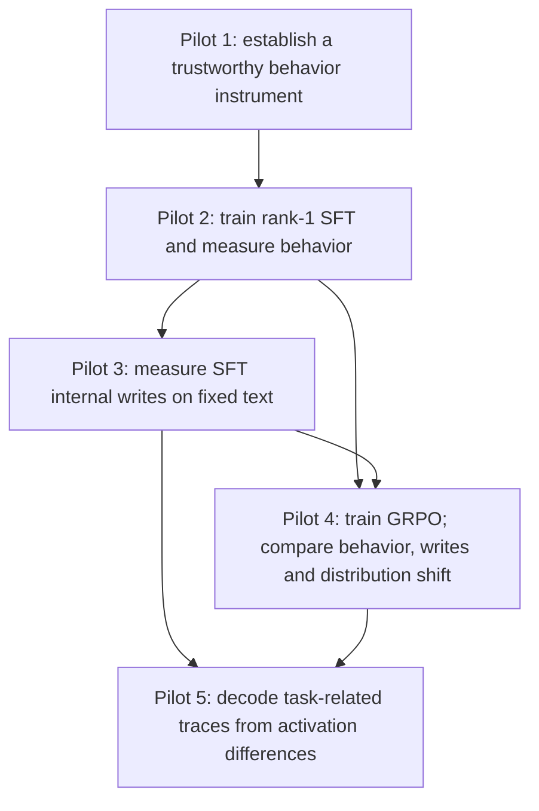

# SPAR pilots 1–5: research and evidence handoff

Prepared 16 October 2026. This is a source-backed map and report-building brief, not a fresh audit of Google Drive or a completed scientific synthesis.

## 1. Research story

**Program question:** How do small rank-1 SFT and reward-trained interventions change behavior and internal computation in the same instruction-tuned model, and can the training task be read from those changes?

Pilot 5 does not depend on finishing Pilot 4's supplemental KL product. Pilots 3 and 5 reuse adapters; they do not train new ones. A random adapter is an intervention control; a random-vector lens null is a different object. The model called “base” in these experiments is Qwen2.5-1.5B-**Instruct** before this project's additional fine-tuning, not Qwen's pretrained base variant.

## 2. Questions, configurations, rationale, limits

| Pilot | Research questions | Core design and why | Evidence boundary |
|---|---|---|---|
| 1 — baseline/instrument | What does the untuned instruction model do on frozen GSM8K/MMLU cohorts? How much do answer extraction and evaluation conventions change measured performance? | GSM8K150 test items; MMLU20 per57 subjects=1,140. Seed42; greedy. MMLU0/5-shot, text and constrained-logit scoring. Freeze actual item lists and templates so comparisons can be paired and audited. | A new protocol, not exact reproduction of older SPAR scores whose prompts/items/scorers were unavailable. Original lower-precision baselines remain separate. |
| 2 — SFT | How do correctness, formatting and response length change across rank-1 gold-solution SFT? | Same pinned Qwen;512 GSM8K training problems, seed42;64 optimizer steps; checkpoints0/8/16/32/64. Rank1, alpha1, dropout0 on196 projections. FP32 unquantized training; completion-only supervision; microbatch1×accumulation8; AdamW LR1e-4, constant schedule, no warmup/weight decay, clip1.0. Gold solutions provide a supervised task signal. | One training seed. Scorer revisions were post hoc. Shorter responses alone do not establish capability damage or its mechanism. Actual executed plan can differ from notebook defaults in hardware/evaluation batch. |
| 3 — SFT writes | Where are local adapter contributions and propagated block-output changes? How do these vary by input/view/checkpoint? | Reuse SFT checkpoints.300 fixed sequences:150 held-out GSM8K with full gold solutions,150 FineWeb passages. Separate question/solution/FineWeb content masks. FP32 eager/no-autocast/no-TF32 forwards; FP64 summaries; token/equal-example weighting. Fixed inputs avoid confusing different generations with model-induced changes. | Local direct writes and total propagated changes are distinct. Magnitudes/directions do not by themselves identify a causal circuit or behavior mechanism. Old T4 and later A10040 executions must retain separate provenance. |
| 4 — GRPO and comparison | Does the reward-trained rank-1 arm preserve/change behavior? How do its writes compare with SFT and a random intervention? How much do conditional output distributions and rank-1 input coefficients change? | Same512 training problems, rank/targets and64 optimizer updates.8 prompts/update×8 sampled completions=4,096 accepted completions. Actual saved run FP32 on A10080; DAPO loss denominator; group reward normalization; correctness flexible-v3; temperature1, top_p1, top_k0, cap1,024; beta0. Checkpoints0/8/16/32/64. Greedy heldout150 at all checkpoints;8 draws/item at0/64. Same fixed300-sequence internal measurement inputs. | Matching problems/rank/steps does not match gold versus sampled training texts, token counts or signal. Not a clean objective-only causal comparison. Post-training KL measurement is separate from a training KL penalty (beta0). One norm-matched random adapter is not a null distribution. |
| 5 — readable traces | Does the mean adapted-minus-base activation on unrelated text decode to task-enriched strings? Do SFT/GRPO differ? How stable is readability to document count and cohort split? |200 raw FineWeb documents: legacy150+disjoint eligible50;128 content tokens/document; no chat template in primary. Existing base/SFT64/GRPO64/random64, endpoints only. All29 sites; FP64 per-position sums/per-example pooled0–4; FP32 retained per-token differences at blocks14,17–21. Primary block14 pooled0–4. Logit and scoped community Jacobian readouts; frozen enriched references; isotropic nulls, document bootstrap, direct contrasts and N-curves. | No new training. Primary is one pooled vector per arm. Readability/overlap is neither semantic ground truth nor a causal mechanism. JLens qualification is scoped and acknowledges incomplete original fit provenance/early-position transfer. No real Pilot5 final scores exist in this handoff. |

**Recorded rationale versus explanation:** Some “why” above explains the design's practical role. For a historical claim that Prasad chose a setting for a particular reason, cite the dated ADR/review; do not infer intention from a plausible benefit.

### Exact run facts already visible locally

- `artifacts/reports/pilot4-results-so-far-2026-10-13/inputs/training-config.json`: FP32; rank1/alpha1/dropout0;28 layers; seven named projection families; optimizer and full ordered groups; A100-SXM4-80GB runtime; pinned revisions.
- Its `frozen-config.json` records the actual1,024 cap, DAPO/scorer, batching and dated retention prediction/non-inferiority margin0.10. These are authoritative for this run, unlike a later notebook's defaults.
- Same snapshot's `sft-write-results.json` records the separately remeasured SFT write execution with A10040 batch8. This is **measurement provenance**, not the GPU on which SFT was trained.
- `artifacts/reports/pilot4-a10040-v2-review/summary.md` records matched A10040 write-report evidence and its limitations.
- Pilot5 endpoints/batch4/FP32, three-hour execution ceiling and20GiB production storage allowance were approved in this chat. Actual plan and reviewed receipts are in Drive; read those files before publishing the settings as independently verified.

## 3. Current completion ledger

Do not equate ticket “resolved” with real-model experiment completion. The ticket often records software completion only. Use completed payload inventories and verify commands, not a status flag alone.

| Product | Last known evidence | Required action for final report |
|---|---|---|
| Pilot1 baseline | Existing reports/local exports; source protocol documented | Reconcile all variants and exact item/scorer/precision identities from Drive. |
| Pilot2 SFT behavior | Saved flexible-v3 audit and paired source responses | Preserve post-hoc label and the audit's stated limits on independent source/config verification. |
| Pilot3/4 writes | Completed GRPO/SFT/random A10040 reports in local snapshots | Reuse scalar results; verify source chain and fetch directions/arrays needed for new analyses. |
| Pilot4 direction comparison, cell27 | User reported completed after the13Oct snapshot | Locate its actual report. Snapshot omission is historical, not evidence it is still absent. |
| Pilot4 coefficients/KL | v1 profile failed coefficient singleton/batch gate; approved ADR0010 repair implemented; no later completed v2 measurements shown here | Inspect Drive v2 plan/profile/status. Resume/review29→30→31→32→33 as appropriate. No retraining/generation. |
| Pilot4 final combined export | Software implemented; supplemental completion unconfirmed |34–36 after all required verified products exist. |
| Pilot5 capture | Supplied cell23 log reports durable completion; user subsequently reported24 complete | Reuse saved capture. No fresh Drive shard audit performed for this handoff. |
| Pilot5 automatic inference | Ticket09 implemented/published; no real scientific execution claimed | CPU25–26 review→26A nulls→27–28 readouts→29 analysis→30 verification. |
| Pilot5 human grading/final presentation | Later work | Keep naming/relevance graders isolated; no external grader calls without approval. |

## 4. Where things live

### Root mappings

- Local repo: `/Users/prasadmahadik/spar/pilot1`.
- GitHub: `https://github.com/mahadikprasad15/spar-pilot`.
- Persistent Google Drive logical root: `My Drive/SPAR/spar-pilot/artifacts`.
- Colab mount of that root: `/content/drive/MyDrive/SPAR/spar-pilot/artifacts`.
- `/content/...` is a Colab runtime path, not a web link or a path automatically available to Claude Desktop. Give Claude local-folder access and/or an actual Drive connector/shared folder. If it cannot access a source, record missing access; do not invent results.
- Colab local harness/download/staging paths are temporary. They are not the canonical result store.
- **`artifacts/` is Git-ignored. Cloning the repo does not provide the scientific results.**

### Repository map

| Path | Purpose / start here |
|---|---|
| `README.md` | Project entrypoint; links five experiment records, shared methods, status and artifact access. |
| `CONTEXT.md` | Project terminology: baseline, direct write, block-output change, weights/views. |
| `.scratch/pilot-1-evaluation/spec.md` | Baseline evaluation design. |
| `.scratch/pilot2-sft/{spec.md,map.md}` | SFT protocol and ticket map. |
| `.scratch/pilot3-write/{spec.md,design.md,map.md}` | Fixed-sequence internal measurements. |
| `.scratch/pilot4-grpo/{spec.md,issues/}` | GRPO design and implementation issues. |
| `.scratch/pilot5-readable-traces/{spec.md,design.md,map.md,issues/}` | Readable-trace design/tickets. Some draft status/scope sentences are superseded by later reviews. |
| `docs/adr/` | Decisions/amendments, including scorer fixes, numerical gates and coefficient policy. Several ADR numbers are reused: use the complete filename. |
| `docs/pilot2-sft.md`, `docs/pilot3-instrument.md` | SFT/instrument operational guides. Read dated follow-ups alongside the current experiment record. |
| `docs/pilot4-{grpo,fixed-writes,token-measurements,final-handoff}.md` | Four distinct GRPO workflows, including remaining KL work. |
| `docs/pilot5-*.md` | Corpus, references, capture/lens qualification, durable capture/readouts, automatic analysis. |
| `notebooks/pilot-{1,2,3,4,5}-colab.ipynb` | Thin stage launchers, pinned to their own harness commits. Opening main is not equivalent to running latest main code. |
| `pilot_eval/cli.py` / `__main__.py` | Public command routing; start from a named notebook command and follow its domain module. |
| `pilot_eval/{protocol,scoring,run,workflow,rescoring}.py` | Baseline inputs/scoring/execution and immutable rescoring. |
| `pilot_eval/sft*.py`, `training.py` | SFT plans, training/evaluation/report and shared state/artifact helpers. |
| `pilot_eval/activation_*.py` | Fixed-input source preparation, masks, calibration, hooks, measurement, reductions and CPU reports. |
| `pilot_eval/grpo_*.py` | GRPO algorithm, rollout training, behavior, random control, write comparison and final handoff. |
| `pilot_eval/token_measurement_*.py` | Supplemental signed coefficients and full-vocabulary forward KL. |
| `pilot_eval/trace_*.py` | Pilot5 corpus, references, capture, lens assets, readouts, scoring/statistics/grading. |
| `tests/` | CPU public-workflow/known-answer tests; optional integration tests can skip without dependencies. Software tests are not scientific outcomes. |
| `output/learning/` | Existing HTML explainers. Use for intuition, not authoritative execution status. |
| `artifacts/plans/` | Actual immutable configs/reviews/parent references. Usually on Drive, not in Git. |
| `artifacts/runs/` | Actual checkpoints, raw responses/shards, runtime, status, seals and summaries. Separate real runs from `diagnostics/` and synthetic fixtures. |
| `artifacts/reports/` | Derived reports/figures and source maps. The HTML is a presentation; JSON/JSONL/NPZ + provenance carry measurements. |

### High-value local result sources

1. `artifacts/reports/pilot4-results-so-far-2026-10-13/`: `report.html`, `source-notes.json`, preserved `inputs/*.json`, `reviewed-snapshot.sqlite`, build/redesign scripts and `deep-dive/`.
2. `artifacts/reports/pilot4-a10040-v2-review/`: readable summary, CSV, figures and source manifests.
3. `artifacts/reports/pilot2-sft-fp32-l4-batch8-v1-flexible-v3/` and `...-audit-v1/`.
4. `artifacts/reports/baseline-gsm8k-flexible-v2/`.
5. `docs/research/available-behavior-snapshot.csv`: starter extraction from the preserved13Oct JSONs. It is not a replacement for the raw-response/source audit.

Drive lookup anchors include `pilot4-grpo-fp32-v1`, `pilot3-inputs-v1`, `pilot3-write-report-v2`, `a10040-v2`, `supplemental-tokens`, `tokens.prepared.json`, `tokens.execution.json`, `pilot5-readable-traces-v1`. Follow stored `run_path`, `source_path`, `*_path` and hashes instead of guessing nested filenames.

Common products: `config.json`, `meta/run_manifest.json`, `meta/runtime.json`, `meta/status.json`, `logs/run.log`, `logs/errors.jsonl`, `results/results.json`, `results/responses.jsonl`, `results/report.md`, `checkpoints/*`, `arrays.npz`, `complete.json`. Exact schema varies by workflow: inspect the corresponding verifier.

## 5. Decisions worth explaining in the report

- Seeds freeze a procedure; **saved ordered IDs and revisions** define the actual cohort.
- Pilot1 lower-precision baseline is not the matched FP32 training-arm baseline.
- Flexible-v3 repairs a strict-valid/flexible-invalid bug. It is a post-hoc score correction on saved responses; preserve old scores and source hashes. See `docs/adr/0005-gsm8k-flexible-v3.md`.
- Quantization, forward dtype, autocast, TF32, storage dtype and reduction dtype are separate settings. Main SFT/GRPO training is unquantized FP32. Measurement uses FP32 forwards/FP64 reductions; Pilot5 retains selected differences as FP32. The community lens's FP16 storage/BF16 fitting history is separate.
- Hardware/batch shape can change numerical forward values. A software resume refusal is a protocol guard, not proof old scientific results became invalid. Changed runtime needs explicit provenance and appropriate qualification; do not demand retraining as a generic remedy.
- Fixed raw/teacher-forced text controls the input for subtraction. Generated response differences are behavior measurements, not matched activation inputs.
- Mean delta norm and mean per-token norm answer different questions because vectors can cancel. Every ratio needs its own stated denominator and weighting.
- KL(tuned||untuned) on fixed contexts is not a global policy-distance or capability score; beta0 in GRPO training does not imply this post-training KL should be zero.
- A random adapter norm-matched to GRPO is not norm-matched to SFT or guaranteed activation-matched. One draw cannot supply a p-value.
- Pilot5 references are top enriched normalized strings, built without learned readouts. Enrichment uses informative-prior log odds, not an add-one frequency ratio. Overlap later measures set membership; absence from a reference is not proof a string is “general.”
- Four primary Pilot5 tests and two direct contrast tests have separate Holm corrections. One arm passing while another fails is not evidence of an arm difference. C3 is the approved bootstrap-tail statistic, not a certified exact/calibrated null test.
- Qualification limits chosen after diagnostics are engineering decisions, not confidence intervals or prospective scientific success thresholds.

## 6. Readiness to share

**Good basis for an internal research review, with a curated entrypoint. Not a polished public reproducibility release yet.** This is a bounded assessment of inspected entrypoints, configs, tests and status records, not an exhaustive code/security review.

Strengths: durable raw outputs, explicit parent/source identities, exact mathematical checks and negative controls, separate stages, resumable batches, versioned scorer revisions and honest numerical limits.

Documentation structure was refreshed on16Oct: README, five experiment records,
shared methods, status ledger, artifact access and an operations index. Use
[the status ledger](../experiments/status.md) as the current consolidated record.
Remaining engineering work includes dense implementation sections, a large central
CLI and broadly specified package extras versus pinned notebook environments.
Scientific artifacts are outside Git; no public artifact download is configured.
No root LICENSE or `.github` CI directory was found in the inspection. The session's
full-suite outcome is recorded separately in [testing](../testing.md).

Before colleague-facing sharing, create a single current overview, a validated config/completion table, one source-backed report, a small example artifact bundle and exact setup instructions for the intended use. Freeze the shared commit. Before public release, resolve license/redistribution and run a scoped secret/data-sharing review. Preserve original artifacts; create sanitized share copies when paths/IDs/credentials need removal. This handoff does not authorize a source-code cleanup, public release or new GPU runs.

AI assistance should be described honestly. The defensible claim is that scientific choices, measurements and limitations are inspectable and that calculations were checked—not that code authorship proves correctness. Avoid claiming a causal mechanism, exact replication, novelty or cross-seed robustness without the relevant evidence.
